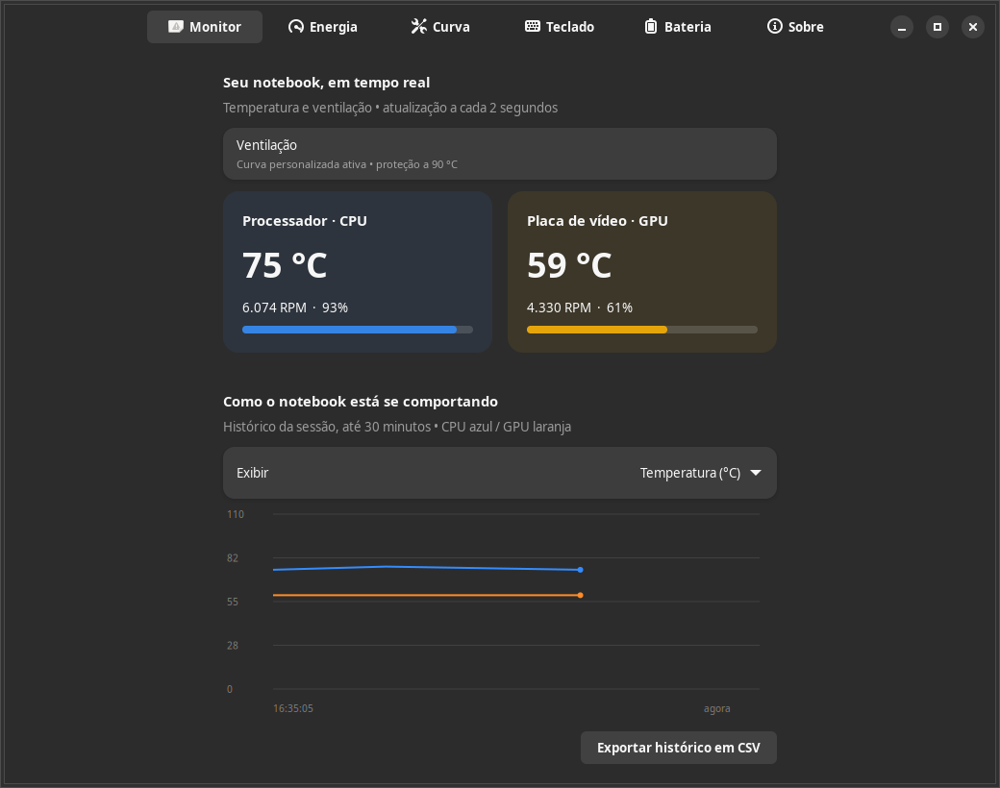
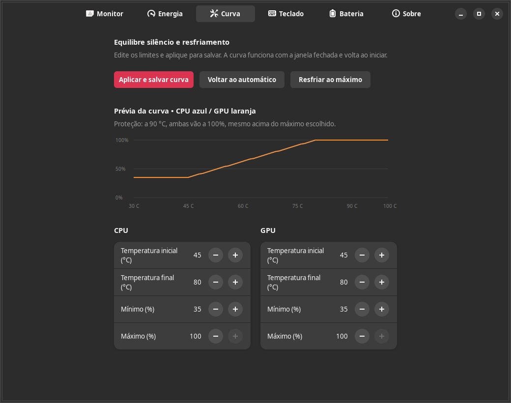
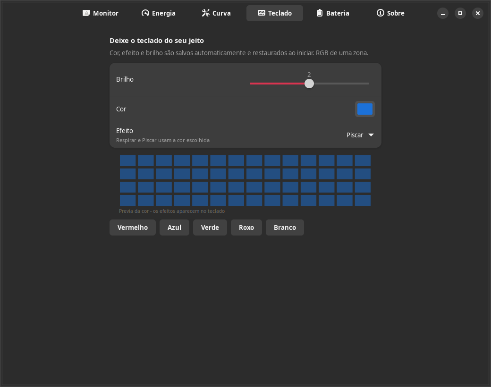

# Avell Linux Control Center

Controle a ventilação, acompanhe temperaturas e personalize a iluminação do **Avell A50i no Linux**, em um painel GTK4 integrado ao desktop.

Este fork é mantido por [lukeexvacui](https://github.com/lukeexvacui), a partir do trabalho de [Luiz Rojas](https://github.com/LuizRojas/avell-linux-control-center). Driver e implementação original creditados ao autor; licença **GPL-2.0-or-later** preservada.

> Projeto não oficial, sem vínculo com Avell, Clevo ou TUXEDO. Instala um módulo de kernel e controla hardware. O suporte deste fork foi validado no A50i descrito abaixo; não presuma compatibilidade com outros modelos.

## Conheça a interface

### Monitoramento

Temperaturas, RPM e potência das ventoinhas a cada 2 segundos. Gráfico de até 30 minutos da sessão, com exportação CSV.



### Curvas de ventilação

Defina temperaturas inicial/final e limites mínimo/máximo para CPU e GPU, com prévia antes de aplicar.



### Iluminação do teclado

Ajuste brilho, cor e efeitos; use os atalhos de cores e acompanhe a prévia. O A50i tem RGB de **uma zona**, sem cores individuais por tecla.



*Capturas reais do aplicativo com sensores do notebook. Temperaturas e rotações são exemplos daquele momento, não metas de funcionamento.*

## Recursos

- Driver adaptado ao kernel Linux 6.8 e conversão corrigida do contador de período para RPM.
- Curvas independentes de CPU/GPU, executadas mesmo com a janela fechada.
- Proteção térmica e watchdog do serviço de ventilação.
- LEDs, perfis de energia e limites de carga da bateria, conforme suporte do firmware.
- Configurações aplicadas salvas e restauradas automaticamente ao iniciar.
- Interface gráfica e comandos pelo terminal.

## Compatibilidade e requisitos

| Item | Ambiente validado neste fork |
|---|---|
| Notebook | Avell A50i / placa HYB A50i, duas ventoinhas |
| BIOS / EC | 1.07.01TBN / 1.07.03 |
| Sistema | Ubuntu 24.04, systemd, sessão gráfica GNOME |
| Kernel | 6.8.0-149-generic |
| Secure Boot | Ativo, com chave de assinatura DKMS já registrada |
| Interface do firmware | ACPI `CLV0001` |

O projeto original relata testes em Debian 13/kernel 6.12. Isso não equivale à validação de todas as alterações deste fork naquele ambiente. A interface usa recursos recentes de GTK4/libadwaita; Ubuntu 22.04 com as bibliotecas padrão não é o ambiente suportado por este guia.

Você precisa de internet para baixar dependências, acesso `sudo` e headers correspondentes ao kernel em execução. Não é necessário ter Windows instalado.

## Instalação fácil com `.deb` (recomendada)

**[Baixar avell-control-center_1.1.0_amd64.deb](https://github.com/lukeexvacui/avell-linux-control-center/releases/download/v1.1.0/avell-control-center_1.1.0_amd64.deb)** · [Notas da release](https://github.com/lukeexvacui/avell-linux-control-center/releases/tag/v1.1.0)

Para **Ubuntu 24.04 de 64 bits (amd64)** no modelo validado. Confira a compatibilidade acima antes de instalar. O pacote contém o código-fonte do driver: ele é compilado localmente por DKMS, não é um módulo pré-compilado para qualquer kernel.

1. Baixe o arquivo `.deb` pelo link acima.
2. Abra um terminal **na pasta em que salvou o arquivo**.
3. Execute:

```bash
sudo apt update
sudo apt install "linux-headers-$(uname -r)"
sudo apt install ./avell-control-center_1.1.0_amd64.deb
```

Use `apt install ./arquivo.deb` para resolver as dependências automaticamente. Aguarde a compilação do driver terminar; ela pode levar alguns minutos. Se o Secure Boot bloquear o carregamento, siga a seção de MOK abaixo: instalar o pacote não dispensa a autorização da chave de assinatura.

Abra **Avell Control Center** no menu ou execute `avell-control-center`. Confira com `avellctl status`. A curva só é ativada após **Aplicar e salvar curva**; preferências existentes de uma instalação manual são preservadas.

### Atualizar ou remover a versão `.deb`

Para atualizar, baixe o `.deb` mais recente e instale com `sudo apt install ./nome-do-arquivo.deb`. O pacote interrompe o serviço durante a troca e restaura as preferências depois. Não combine esse método com `install.sh`/`uninstall.sh` depois de passar a usar o pacote.

```bash
# Remover o aplicativo, mantendo as preferências para uma futura instalação:
sudo apt remove avell-control-center

# OU remover também as preferências salvas:
sudo apt purge avell-control-center
```

O pacote devolve os canais ao controle do firmware antes de remover o driver. Guarde um backup de `/var/lib/avell-cc/state.json` se quiser preservar as opções antes do purge.

### Conferir integridade e construir o pacote

A release também inclui `SHA256SUMS`. Baixe-o para a mesma pasta do `.deb` e confira:

```bash
sha256sum -c SHA256SUMS
```

Para gerar o pacote a partir deste repositório, sem privilégios de administrador:

```bash
python3 packaging/build-deb.py
```

O resultado fica em `dist/`. A construção requer `dpkg-deb` e Python 3. As fontes do driver, aplicativo, serviços e instruções ficam dentro do pacote; preferências pessoais, chaves de assinatura e binários proprietários não são incluídos.

## Instalação pelo código-fonte — Ubuntu 24.04 (alternativa)

### 1. Confira o notebook e o kernel

Abra um terminal e execute:

```bash
cat /sys/class/dmi/id/product_name
uname -r
ls -d /sys/bus/acpi/devices/CLV0001:*
```

O modelo validado é `A50i`. O último comando deve encontrar uma interface como `CLV0001:00`. Se ela não existir, não force a detecção: este driver pode não ser adequado ao equipamento. Outros modelos e kernels precisam de validação própria.

### 2. Prepare o sistema

```bash
sudo apt update
sudo apt install git build-essential dkms mokutil "linux-headers-$(uname -r)"
```

Se o pacote de headers não estiver disponível, resolva a instalação do kernel/headers antes de continuar. O compilador precisa das definições da versão exata em execução.

### 3. Baixe e instale

```bash
git clone https://github.com/lukeexvacui/avell-linux-control-center.git
cd avell-linux-control-center
sudo ./install.sh
```

O instalador:

1. Instala as dependências Python, GTK4/libadwaita e Cairo para os gráficos.
2. Compila e instala `avell_dchu` por DKMS.
3. Instala o painel, `avellctl` e o serviço de curvas.
4. Habilita a restauração das configurações no boot.
5. Carrega o driver e exibe o estado do equipamento.

A instalação também adiciona uma política polkit que permite ao usuário da sessão local ativa alterar as opções suportadas sem pedir senha a cada clique. O driver inicializa o perfil equilibrado e o teclado; personalize-os depois da instalação.

**A primeira instalação não ativa uma curva personalizada automaticamente.** Abra a aba Curva e clique em **Aplicar e salvar curva** quando estiver pronto. DKMS tenta recompilar o driver em atualizações do kernel, mas a compatibilidade com kernels novos não é garantida.

### 4. Se o Secure Boot impedir o carregamento

Confira:

```bash
mokutil --sb-state
```

Erros como `Key was rejected by service` indicam que a assinatura pode não ser confiável para o sistema. No Ubuntu, o DKMS normalmente assina o módulo com uma chave MOK; o certificado precisa estar registrado.

Se a instalação solicitar uma senha temporária de MOK, anote-a, reinicie quando puder e conclua o cadastro na tela **MokManager → Enroll MOK → Continue → Yes**, usando essa senha. Ela é específica para esse cadastro.

Se não houver solicitação, confira o caminho de **Public certificate** mostrado pelo DKMS. Quando ele for `/var/lib/shim-signed/mok/MOK.der`, você pode verificar e solicitar o cadastro:

```bash
sudo mokutil --test-key /var/lib/shim-signed/mok/MOK.der
# Execute a importação apenas se o certificado existir e não estiver registrado:
sudo mokutil --import /var/lib/shim-signed/mok/MOK.der
```

Depois de concluir o cadastro e voltar ao Ubuntu:

```bash
sudo modprobe avell_dchu
sudo systemctl restart avell-cc-restore.service
avellctl status
```

Não importe arquivos de chave privada. Caminhos e procedimentos podem variar em outras distribuições. Consulte a [documentação oficial de Secure Boot do Ubuntu](https://documentation.ubuntu.com/security/security-features/platform-protections/secure-boot/).

### 5. Abra e confira o painel

Procure **Avell Control Center** no menu de aplicativos ou execute, como seu usuário normal:

```bash
avell-control-center
```

No terminal, confira a instalação:

```bash
avellctl status
dkms status -m avell-dchu
systemctl is-enabled avell-cc-restore.service
```

Espere ver o driver instalado, sensores CPU/GPU e `enabled` para a restauração. Não execute a interface gráfica com `sudo`.

## Primeiro uso

### Configure sua curva

1. Abra **Curva**.
2. Para cada componente, escolha a temperatura em que a ventilação começa a subir e aquela em que chega ao máximo.
3. Defina mínimo e máximo em **porcentagem de ventilação, não RPM**.
4. Confira a prévia e clique em **Aplicar e salvar curva**.
5. Veja no Monitor se a potência e a rotação respondem ao ajuste.

O formulário começa com **35% até 45 °C, subindo linearmente até 100% a 80 °C**. Temperaturas editáveis vão de 30 a 85 °C e ventilação de 30 a 100%. Início deve ser menor que fim, e mínimo não pode superar máximo.

**Proteções que prevalecem sobre sua curva:**

- A 90 °C em qualquer componente, ambas as ventoinhas recebem 100%, mesmo acima do máximo escolhido.
- Reduções são limitadas a 5 pontos percentuais por ciclo; aumentos são imediatos.
- Falta de sensor, rotação inválida ou divergência na potência lida interrompem a curva e solicitam ventilação máxima.
- O watchdog de 10 segundos e o encerramento do serviço também acionam essa proteção. Isso depende de o sistema/driver ainda conseguir comunicar-se com o hardware.

Fechar a janela **não para** a curva. Use **Voltar ao automático** para devolver o controle ao firmware ou **Resfriar ao máximo** para solicitar 100%.

### Configure os LEDs

Na aba **Teclado**, escolha brilho, uma cor e um efeito. Cada alteração aplicada é salva automaticamente. A prévia mostra a cor; a animação dos efeitos aparece no teclado físico. Os efeitos disponíveis dependem do modelo.

### Acompanhe e exporte

Na aba **Monitor**, alterne entre temperatura, RPM e ventilação. **Exportar histórico em CSV** salva os dados em `Avell/` dentro da pasta Documentos configurada no desktop. O gráfico guarda até 30 minutos enquanto a janela está aberta; não é um registro permanente em segundo plano.

## Restauração ao reiniciar

As opções aplicadas ficam em `/var/lib/avell-cc/state.json`. O serviço `avell-cc-restore.service` carrega o driver e restaura as opções salvas, inclusive LEDs e curva quando selecionada. Não é necessário abrir o painel para a curva funcionar.

Para testar a restauração sem reiniciar o notebook:

```bash
sudo systemctl restart avell-cc-restore.service
avellctl status
```

Se uma curva estiver selecionada:

```bash
systemctl status avell-fan-curve.service --no-pager
```

O serviço de restauração é do tipo `oneshot`: pode aparecer `inactive (dead)` depois de executar com sucesso. Confira o resultado com:

```bash
systemctl show avell-cc-restore.service -p Result -p ExecMainStatus -p UnitFileState
```

O resultado esperado é `success`, código `0` e `enabled`.

## Atualizar uma instalação pelo código-fonte

Antes de atualizar, volte ao automático para não deixar o serviço usando o driver durante a troca:

```bash
avellctl fan auto
cd avell-linux-control-center
git pull --ff-only
sudo ./install.sh
```

Feche e reabra o painel. A configuração da curva continua salva, mas o comando acima muda o modo ativo para automático; reaplique sua curva na interface se quiser usá-la novamente. Alterações locais no código podem exigir resolver conflitos antes de atualizar.

## Remover uma instalação pelo código-fonte

Dentro da pasta do projeto:

```bash
avellctl fan auto
sudo ./uninstall.sh
```

A desinstalação remove o aplicativo, o módulo DKMS, os serviços e **as configurações salvas**. Para guardar suas preferências antes, copie o arquivo:

```bash
sudo cat /var/lib/avell-cc/state.json > avell-settings-backup.json
```

## Problemas comuns

| Sintoma | O que conferir |
|---|---|
| `Driver não carregado` | Execute `sudo modprobe avell_dchu` e leia o erro; confira Secure Boot e `dkms status`. |
| Erro ao compilar | Confira `uname -r`, headers e o log `/var/lib/dkms/avell-dchu/1.0.0/build/make.log`. |
| Gráficos não abrem | Confira `python3-cairo` e `python3-gi-cairo`; execute o painel no terminal para ver o erro. |
| Biblioteca GTK/Adwaita incompatível | Use o ambiente validado Ubuntu 24.04; distribuições antigas podem não ter as APIs necessárias. |
| Curva parou e ventilação ficou no máximo | Veja os logs abaixo. Corrija a causa antes de reaplicar; o máximo pode ser a proteção funcionando. |
| Curva não aceita outro notebook | O serviço restringe o controle ao A50i com duas ventoinhas. Não contorne a verificação sem validar o protocolo do modelo. |
| Sem cor individual por tecla | O A50i tem teclado RGB de uma zona. |

Logs úteis:

```bash
journalctl -b -u avell-fan-curve.service -u avell-cc-restore.service --no-pager -n 80
sudo journalctl -k -b --no-pager -g avell
```

Ao abrir uma issue, informe modelo, BIOS/EC, distribuição, kernel, saída de `avellctl status` e os erros relevantes. Revise os logs para remover informações pessoais.

## Validação e limitações

Testados no notebook: compilação e carregamento com Secure Boot, RPM, velocidades independentes de 100/90%, curva em execução, falha forçada do serviço acionando máxima e restauração das opções via serviço. **Reinício completo e suspensão reais ainda não foram validados.** Um intervalo prolongado no monitoramento, inclusive após suspensão, interrompe a curva e solicita máxima.

Testes locais sem escrever no hardware:

```bash
python3 test_curve.py
python3 test_rpm.py
make -C driver
```

O último comando só compila o módulo; não instala nem carrega. As proteções de software não substituem refrigeração funcional ou avaliação de defeito físico.

## Código, protocolo e contribuições

- `driver/`: módulo ACPI/DCHU e sensores hwmon.
- `avell_cc/`: interface, CLI, persistência e serviço de curvas.
- `data/`: serviços, política polkit e integração com o menu.
- [Protocolo DCHU](docs/PROTOCOLO.md) e [notas de drivers do projeto original](docs/DRIVERS.md).
- [Referência Windows das operações por canal](https://github.com/XiaoQing235/ClevoFanControl/blob/3531063f718952cb789353b5c407eb5594cf274e/src/hardware.rs).

Abra issues e pull requests neste fork, contra `main`. Mudanças de hardware devem informar modelo, BIOS, kernel e como foram verificadas. O repositório não distribui os binários proprietários do Control Center Windows.

## Licença e créditos

**GPL-2.0-or-later** — veja [LICENSE](LICENSE). Base original de [Luiz Rojas](https://github.com/LuizRojas/avell-linux-control-center), com adaptações de kernel, RPM, curvas e interface mantidas neste fork.
